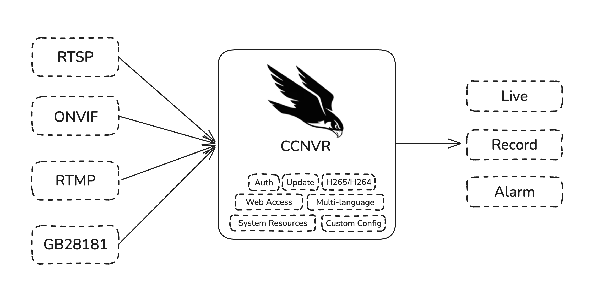
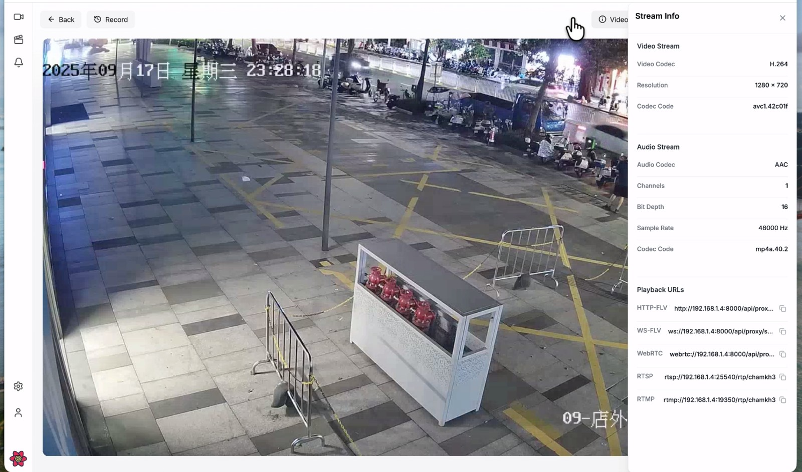
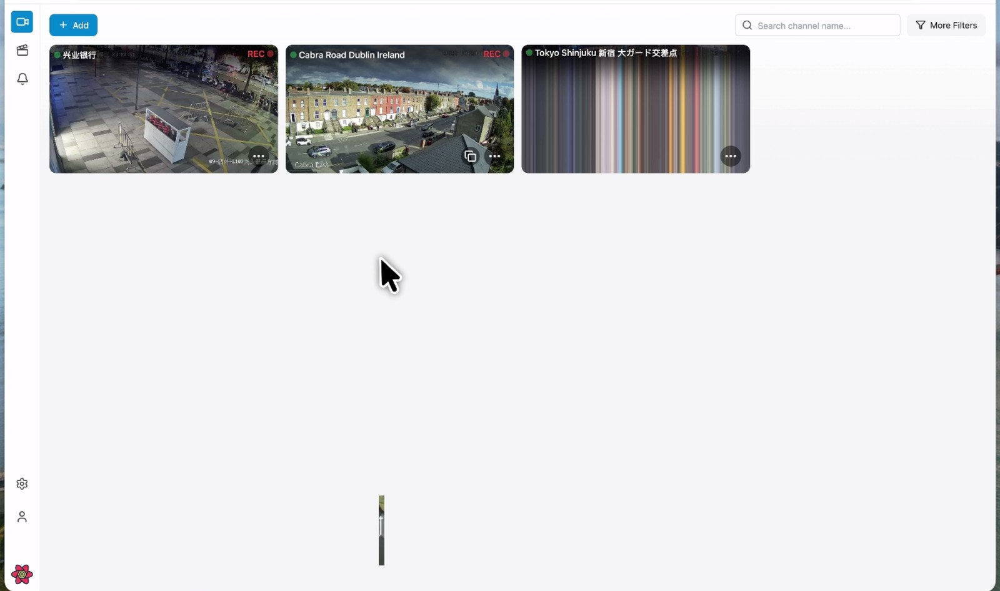
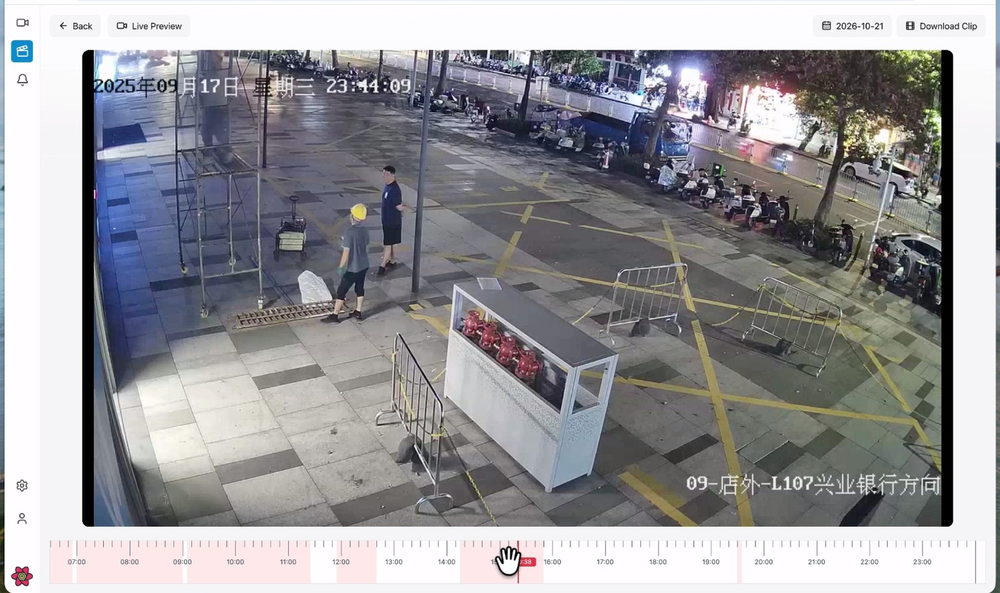

<h1 align="center">
  <picture>
    <source media="(prefers-color-scheme: dark)" srcset="assets/brand/ccnvr-logo-dark.png">
    
  </picture>
  <br>
  CCNVR
</h1>

<p align="center">
  <strong>Lightweight, self-hosted NVR for ONVIF / RTSP / RTMP / GB28181 cameras.</strong><br>
  Live view · recording · playback · PTZ · WebRTC / FLV · H.265
</p>

<p align="center">
  <a href="https://ccnvr.com">Website</a> ·
  <a href="https://demo.ccnvr.com">Live demo</a> ·
  <a href="https://ccnvr.com/docs/getting-started">Docs</a> ·
  <a href="https://github.com/ccnvr/ccnvr/releases/latest">Releases</a> ·
  <a href="https://github.com/ccnvr/ccnvr/issues">Issues</a>
</p>

<p align="center">
  <a href="https://github.com/ccnvr/ccnvr/releases/latest"></a>
  <a href="LICENSE"></a>
  
</p>

<p align="center">
  <strong>English</strong> · <a href="README.zh-CN.md">简体中文</a>
</p>

---

CCNVR is a self-hosted network video recorder for small and mid-size deployments. One package contains the server, web console, media server and a static ffmpeg — no plugin, cloud account or external media server.

This repository distributes releases only; CCNVR is proprietary and the source is not published.



## Live demo

| URL | Username | Password |
| --- | --- | --- |
| <https://demo.ccnvr.com> | `ccnvr_user` | `ccnvr_user` |

Shared instance — please don't change the password or delete devices.Some features are hidden; you can install them yourself.

## Features

| | |
| --- | --- |
| **Ingest** | RTSP, ONVIF, RTMP push, GB28181 |
| **Web playback** | WebRTC, HTTP-FLV, WS-FLV — no plugin, sub-second latency |
| **Recording** | Continuous / event plans, weekly schedules, per-plan retention |
| **Playback** | Timeline, download, storage cleanup |
| **PTZ** | ONVIF and GB28181 |
| **Codec** | H.264 / H.265, including in-browser H.265 |
| **Alarms & events** | GB28181 alarms, AI events, snapshots, webhook |
| **Access control** | Users, roles, per-channel permissions |
| **Deployment** | Windows, Linux, Docker |

## Screenshots

**Live view** — video, stream info and playback URLs in one screen.



| **Devices** | **Playback** |
| --- | --- |
|  |  |
| Live thumbnails and recording status | Timeline playback, date picker and clip download |

## Quick start

The first visit opens the setup wizard: language, network, product name and admin password. Default account is `admin` / `admin`; the default password cannot be kept.

### Windows

1. Download `ccnvr-windows-amd64-<version>.zip` from [Releases](https://github.com/ccnvr/ccnvr/releases/latest) and extract it.
2. Run **`start.bat`** and allow the firewall prompt.
3. Open <http://localhost:16188>. Stop with **`stop.bat`**.

### Linux

```bash
tar -xzf ccnvr-linux-amd64-*.tar.gz
cd ccnvr-linux-amd64
./start.sh                 # background start, prints the access URLs
sudo ./start.sh service    # optional: systemd, start on boot
```

Stop with `./stop.sh`. All default ports are above 1024, so `./start.sh` does not need root.

### Docker

```bash
docker run -d --name ccnvr --restart always \
  -p 16188:16188 \
  -p 15060:15060/tcp -p 15060:15060/udp \
  -p 31100-31200:31100-31200/tcp -p 31100-31200:31100-31200/udp \
  -v /opt/ccnvr/configs:/opt/media/bin/configs \
  -v /opt/ccnvr/records:/opt/media/bin/records \
  ccnvr/ccnvr:latest
```

- `configs` holds the config, database, machine ID and license — always mount it.
- GB28181 requires **UDP 15060**, in the host firewall and the cloud security group.
- ONVIF discovery needs `--network host` on Linux; on Windows/macOS add cameras by RTSP URL.

## Ports

| Port | Purpose |
| --- | --- |
| 16188 | Web console and API — **required** |
| 15060 | GB28181 SIP — TCP + UDP |
| 31100–31200 | GB28181 media — TCP + UDP |
| 25540 / 19350 / 31300 | Optional RTSP / RTMP / WebRTC — off by default |
| 16198 | Internal media API — **never expose** |

On a cloud server, open these in the security group as well as the host firewall.

## Support

| | |
| --- | --- |
| Bugs and feature requests | [GitHub Issues](https://github.com/ccnvr/ccnvr/issues) |
| Licensing and OEM | [Contact page](https://ccnvr.com/docs/contact) |
| Security | [Private advisory](https://github.com/ccnvr/ccnvr/security/advisories/new) — not a public issue |

You can also reach us directly by scanning a QR code:

| WeChat | WhatsApp |
| --- | --- |
|  |  |

---

<p align="center">
  <sub>© 2026 CCNVR. All rights reserved. See <a href="LICENSE">LICENSE</a>.</sub>
</p>
