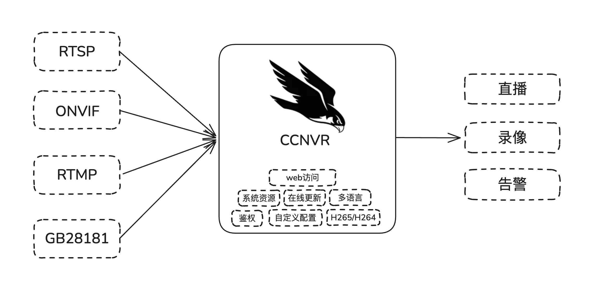

<h1 align="center">
  <picture>
    <source media="(prefers-color-scheme: dark)" srcset="assets/brand/ccnvr-logo-dark.png">
    
  </picture>
  <br>
  ccnvr
</h1>

<p align="center">
  <strong>轻量级自托管网络录像机（NVR），支持 ONVIF / RTSP / RTMP / GB28181 接入。</strong><br>
  实时预览 · 录像回放 · 云台控制 · WebRTC / FLV · H.265
</p>

<p align="center">
  <a href="https://ccnvr.com">官网</a> ·
  <a href="https://demo.ccnvr.com">在线演示</a> ·
  <a href="https://ccnvr.com/docs/getting-started">文档</a> ·
  <a href="https://github.com/ccnvr/ccnvr/releases/latest">下载</a> ·
  <a href="https://github.com/ccnvr/ccnvr/issues">问题反馈</a>
</p>

<p align="center">
  <a href="https://github.com/ccnvr/ccnvr/releases/latest"></a>
  <a href="LICENSE"></a>
  
</p>

<p align="center">
  <a href="README.md">English</a> · <strong>简体中文</strong>
</p>

---

CCNVR 是一套开箱即用的自托管网络录像机，面向中小型场景。一个安装包内含服务端、网页控制台、流媒体服务和静态 ffmpeg，不需要插件、云账号或额外部署流媒体服务器。

本仓库只发布安装包；CCNVR 为闭源软件，不提供源代码。



## 在线演示

| 地址                     | 账号         | 密码         |
| ------------------------ | ------------ | ------------ |
| <https://demo.ccnvr.com> | `ccnvr_user` | `ccnvr_user` |

多人共用环境，请不要修改密码或删除设备，部分功能隐藏可自行安装。

## 功能特性

|                |                                                   |
| -------------- | ------------------------------------------------- |
| **协议接入**   | RTSP、ONVIF、RTMP 推流、GB28181                   |
| **网页播放**   | WebRTC、HTTP-FLV、WS-FLV，免插件、毫秒级延迟      |
| **录像**       | 连续录像 / 事件录像、按周计划、按计划设置保留天数 |
| **回放**       | 时间轴回放、录像下载、存储清理                    |
| **云台**       | ONVIF 与 GB28181                                  |
| **编码**       | H.264 / H.265，支持浏览器内 H.265 解码            |
| **报警与事件** | GB28181 报警、AI 事件、抓图、Webhook              |
| **权限**       | 多用户、角色、按通道授权                          |
| **部署**       | Windows、Linux、Docker                            |

## 界面截图

**实时预览** —— 视频、码流信息和播放地址同屏显示。


| **设备列表** | **录像回放** |
| --- | --- |
|  |  |
| 实时缩略图与录像状态 | 时间轴回放与录像下载 |

## 快速开始

首次访问进入初始化向导：设置语言、网络参数、产品名称和管理员密码。默认账号 `admin` / `admin`，默认密码不允许保留。

### Windows

1. 从 [Releases](https://github.com/ccnvr/ccnvr/releases/latest) 下载 `ccnvr-windows-amd64-<version>.zip` 并解压。
2. 双击 **`start.bat`**，在防火墙提示中点击允许。
3. 打开 <http://localhost:16188>。停止用 **`stop.bat`**。

### Linux

```bash
tar -xzf ccnvr-linux-amd64-*.tar.gz
cd ccnvr-linux-amd64
./start.sh                 # 后台启动，并打印访问地址
sudo ./start.sh service    # 可选：安装 systemd 服务，开机自启
```

停止用 `./stop.sh`。默认端口都在 1024 以上，`./start.sh` 不需要 root。

### Docker

```bash
docker run -d --name ccnvr --restart always \
  -p 16188:16188 \
  -p 15060:15060/tcp -p 15060:15060/udp \
  -p 31100-31200:31100-31200/tcp -p 31100-31200:31100-31200/udp \
  -v /opt/ccnvr/configs:/opt/media/bin/configs \
  -v /opt/ccnvr/records:/opt/media/bin/records \
  ccnvr/ccnvr:latest
```

- `configs` 存放配置、数据库、机器码和授权，必须挂载。
- GB28181 需要放行 **UDP 15060**，主机防火墙和云安全组都要配置。
- ONVIF 自动发现需要 `--network host`（Linux）；Windows / macOS 请用 RTSP 地址添加。

## 端口

| 端口                  | 用途                                  |
| --------------------- | ------------------------------------- |
| 16188                 | 网页控制台和 API —— **必需**          |
| 15060                 | GB28181 SIP —— TCP + UDP              |
| 31100–31200           | GB28181 媒体 —— TCP + UDP             |
| 25540 / 19350 / 31300 | 可选 RTSP / RTMP / WebRTC —— 默认关闭 |
| 16198                 | 内部媒体 API —— **严禁对外暴露**      |

云服务器上，除主机防火墙外还要在云厂商安全组放行。

## 技术支持

|                    |                                                                                            |
| ------------------ | ------------------------------------------------------------------------------------------ |
| 缺陷反馈与功能建议 | [GitHub Issues](https://github.com/ccnvr/ccnvr/issues)                                     |
| 商业授权与 OEM     | [联系页面](https://ccnvr.com/docs/contact)                                                 |
| 安全漏洞           | [私密安全公告](https://github.com/ccnvr/ccnvr/security/advisories/new)，不要提交公开 Issue |

也可以直接扫码联系我们：

| 微信                            | WhatsApp                             |
| ------------------------------- | ------------------------------------ |
|       |      |

---

<p align="center">
  <sub>© 2026 CCNVR. 保留所有权利，授权条款见 <a href="LICENSE">LICENSE</a>。</sub>
</p>
